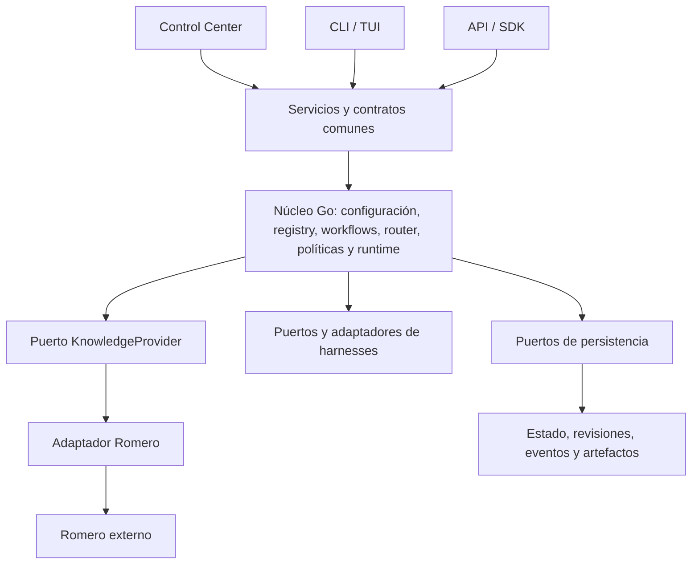
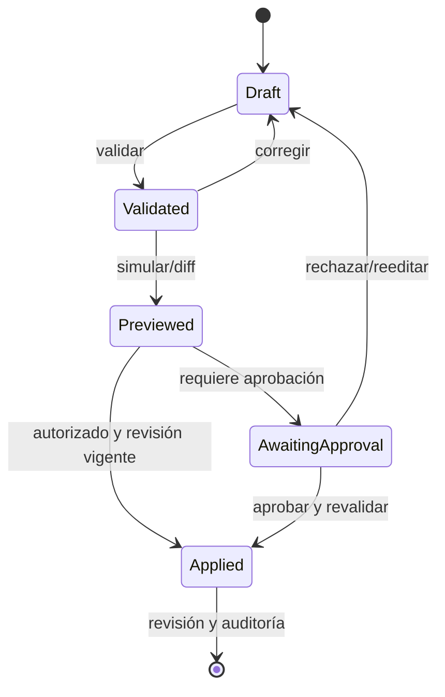

# GW-57 — Gandalf Control Center

| Control | Valor |
|---|---|
| Documento | GW-57-CONTROL-CENTER-SPEC |
| Revisión | 1.1.0-draft |
| Fecha | 2026-11-19 |
| Autoridad | GW-SPEC-001 v1.1.0-draft, DEC-11 |
| Estado | Alcance integrado; diseño técnico pendiente de implementación y pruebas |

Este anexo desarrolla los requisitos canónicos de [GW-SPEC-001](GANDALF_WIZARD_ESPECIFICACION_MAESTRA.md), GW-57 y A.10. No sustituye contratos, políticas ni requisitos de otras áreas. El [PDF v0.1](GW-57_Gandalf_Control_Center.pdf) conserva los mockups originales de las páginas 3–5; la arquitectura de su página 8 y la numeración de su página 9 se interpretan según esta revisión. No hay una aplicación funcional ni se ha inspeccionado el repositorio.

## 1. Alcance y responsabilidades

## GW-57. Gandalf Control Center — administración interactiva universal

**Estado:** alcance objetivo confirmado por DEC-11; especificación de diseño, no funcionalidad implementada. GW-57 amplía GW-51 y GW-52. Debe permitir al usuario autorizado administrar todo comportamiento expuesto por contratos de configuración, no modificar arbitrariamente invariantes del núcleo, restricciones externas o derechos de terceros. CLI, TUI, API, SDK y panel deben usar los mismos servicios y políticas efectivos. GW-51 posee el motor de configuración; GW-52 define contratos y comportamiento común de interfaces; GW-57 compone la experiencia gráfica. No crear un segundo runtime, router, catálogo o almacén canónico.

| ID | Requisito | Alcance normativo |
|---|---|---|
| GW-57.1 | Administración central | CRUD conforme a ciclo de vida, búsqueda, filtros, versiones, perfiles, instalaciones, proyectos, catálogos, agentes, recursos y observabilidad. La eliminación respeta dependencias, retención y evidencias. |
| GW-57.2 | Control de preferencias | Visualizar recomendación original, alternativas, restricciones, estimaciones e incertidumbre; editar pesos, fijar/excluir harnesses, modelos y esfuerzos, configurar fallback, aplicar overrides por ámbito y restaurar recomendaciones. |
| GW-57.3 | Configuración universal | Edición visual y avanzada YAML/JSON/Markdown según contrato; manifiestos, reglas, capacidades declaradas, requisitos y extensiones. No falsificar capacidades verificadas ni editar invariantes como preferencias. |
| GW-57.4 | Composición visual | Constructor de workflows, agentes, equipos, harnesses, dominios y metodologías; nodos, aristas, ramas, subworkflows, bucles acotados, entradas/salidas, dependencias y gates; importar/exportar IR sin pérdida semántica. |
| GW-57.5 | Operación supervisada | Dashboard, actividades, progreso, eventos, costos, cuotas, alertas, aprobaciones, evidencias, pausa/reanudación/cancelación y replanificación en puntos seguros cuando la modalidad y capacidades lo permitan. |
| GW-57.6 | Gobierno de cambios | Borradores, validación, simulación, diff, previsualización de compilación, aprobación, aplicación versionada, auditoría, snapshots, deshacer/rehacer, restauración y concurrencia controlada. |

### GW-57.a. Superficies y experiencia

El dashboard DEBE abarcar objetivos, proyectos, dominios, metodologías, estrategias, harnesses, modelos, router, catálogos de skills/patrones/reglas, agentes/equipos, workflows/runtime, herramientas/contexto, Romero/Documentación, Entrepreneur, evaluación/benchmarks, aprendizaje, seguridad y recursos. Cada tipo de recurso DEBE declarar acciones posibles, estado de capacidad, permisos efectivos, origen, revisión y restricciones. La [matriz de trazabilidad y superficies](REQUIREMENTS_TRACEABILITY.md) establece cobertura por las 57 áreas, no una promesa de edición incondicional. El panel DEBE permitir personalización del dashboard, asistente conversacional de configuración, constructor de harnesses y dominios, generador de skills, editor de código, terminal autorizada y explorador de archivos/repositorios dentro de permisos y aislamiento.

Modos de interfaz: Recommended (guiado), Advanced (edición detallada), Expert (edición directa de formatos y parámetros expuestos). Son modos de experiencia, no roles de seguridad ni perfiles del router. Mantener CLI/TUI, SDK y acceso API funcionales sin frontend. Las tres maquetas de las páginas 3–5 del PDF histórico son referencias estáticas, no capturas de una aplicación implementada.

### GW-57.b. Gobierno, seguridad y reversibilidad

Mostrar configuración recomendada, declarada, personalizada y efectiva con procedencia por campo. Aplicar la precedencia de GW-21 y GW-51; políticas de GW-42 y GW-43 son obligatorias. Los conflictos de igual prioridad se resuelven por regla declarada o se bloquean/escalan. El usuario no puede convertir una preferencia en permiso ni editar evidencias verificadas como si fueran preferencias. Editor, terminal, asistente y extensiones pasan por autorización efectiva, sandbox, validación de comandos/archivos/red y registro; las rutas alternativas no pueden escribir directamente en estados canónicos saltándose el núcleo. No mostrar secretos en manifiestos, exportaciones, logs ni vistas. Las modificaciones de objetivos, permisos, políticas obligatorias y gates requieren autoridad y reevaluación de alcance; no pueden autoaprobarse por un agente limitado por ellas.

Flujo de cambio: editar → validar → simular cuando corresponda → revisar diff → aprobar si aplica → aplicar de forma atómica y versionada → auditar. La simulación no ejecuta efectos externos. La restauración crea una nueva revisión auditada y no revierte por sí sola efectos externos; revalidar permisos y compatibilidad actuales. Las aprobaciones se vinculan a acción, revisión, alcance y vigencia; cambios sustanciales las invalidan. Las escrituras concurrentes con revisión obsoleta deben rechazarse con diagnóstico en lugar de sobrescribir silenciosamente.

### GW-57.c. Router y Workflow Builder

El router visual usa exactamente las restricciones, normalización, incertidumbre, candidatos y perfiles de GW-21. Pesos finitos y no negativos, suma positiva y normalización en el núcleo; los valores 40/25/15/20 del prototipo son ilustrativos. Fijaciones estrictas no se sustituyen sin decisión autorizada; verificar esfuerzo nativo y no inventar equivalencias, cuotas ni capacidades. Los perfiles canónicos se definen en el anexo técnico; separar perfil de optimización de modo de interfaz.

El Workflow Builder opera sobre la IR independiente del proveedor de GW-14. Los metadatos de presentación (posición, zoom, tema y selección) no alteran la semántica de la IR ni son requisitos de ejecución. Validar referencias, contratos tipados, dependencias, ciclos acotados, capacidades, presupuesto y políticas; la previsualización de compilación es sin escritura ni ejecución. Un borrador no altera un plan activo. Mantener inmutable cada revisión del plan; replanificar a una revisión nueva en checkpoint/punto seguro, preservar historial, congelar tareas en curso salvo protocolo autorizado, reevaluar aprobaciones y reconciliar efectos externos antes de reintentar. Si el harness o modo compilador no admite intervención en runtime, mostrar limitación y no simular éxito.

### GW-57.d. Arquitectura y contratos

Romero conserva su responsabilidad externa de conocimiento, permisos, fuentes y originales conforme a GW-04. Solo operar capacidades verificadas y escrituras derivadas autorizadas a través de los contratos; administración de integración no supone control directo de almacenamiento de Romero. Go es confirmado. React/TypeScript, React Flow, Monaco, Tailwind CSS, shadcn/ui, REST, WebSocket/SSE, SQLite y Wails son candidatos sujetos a ADR y pruebas; no dependencias aprobadas. API versionada, autorización de lectura/escritura y control de concurrencia obligatorios. Ver A.10 y [anexo técnico GW-57](GW-57_CONTROL_CENTER_SPEC.md) para contratos lógicos, requisitos y criterios.

### GW-57.e. Aceptación

AC-17–24 son los ocho escenarios globales de esta extensión (reemplazan los AC-01–08 locales del PDF v0.1). Aplicar también los criterios base pertinentes y la Definition of Done de C.4. No declarar alcance implementado sin pruebas reproducibles. Las diez fases de C.1 incluyen el panel de forma incremental según disponibilidad de contratos, políticas y capacidades; no se crea un roadmap independiente.

## 2. Modelo de operación y experiencia

| Vista / superficie | Funciones | Validación |
|---|---|---|
| Dashboard | Selección proyecto/ejecución, tareas, progreso, dependencias, actividad, alertas, indicadores observados/estimados/desconocidos, accesos y aprobaciones; personalización. | Procedencia, estado y fecha de indicadores; aislamiento por proyecto. |
| Proyectos y objetivos | ODD, criterios, restricciones, entornos, perfiles, alcance y recursos. | Versionado y autorización de cambios a objetivo. |
| Catálogos | Búsqueda, filtros, crear, editar, duplicar, archivar, combinar y versionar skills, patrones, reglas, prompts, instrucciones, antipatrones, metodologías y evaluaciones. | Registro propio, licencia, dependencias, integridad y revisión de publicación. |
| Workflow Builder | Selección de nodos, agregar, editar, eliminar, duplicar, reordenar, conectar, drag-and-drop, ramas, subworkflows, bucles acotados, equipos, gates y parámetros. | IR tipada, semántica preservada en YAML/JSON, layout independiente. |
| Model Router | Selección manual/automática, pesos, perfiles, bloqueo, exclusión, modelo, esfuerzo, harness, fallback, restauración y exportación JSON. | Elegibilidad antes de puntuar, presupuesto, capacidades verificadas y registro de decisión. |
| Agentes y equipos | Roles, herramientas, instrucciones, jerarquías, handoffs, permisos y colaboración. | Límites de delegación, aislamiento y no autoampliación. |
| Harness Builder y Domain Builder | Componer configuraciones y extensiones, probar contratos, ver compatibilidad y diffs por destino. | No cambiar lógica central ni afirmar capacidades sin prueba; compilación preview sin efectos. |
| Romero y Documentación | Configurar proveedor por referencia, fuentes autorizadas, recuperación, profundidad L1–L10, cobertura, evidencia, revisiones, grafos y especialistas. | Acceso por puerto; originales intactos; estados de capacidad y revisión explícitos. |
| Entrepreneur | Metodologías, equipos, hipótesis, experimentos, score/rúbricas, riesgos y criterios de viabilidad. | Datos e hipótesis diferenciados; decisiones vinculadas a evidencia; autorización de efectos externos. |
| Runtime y recursos | Pausa, reanudación, cancelación, checkpoints, reintentos, timeouts, concurrencia, presupuesto y seguimiento. | Disponibilidad por modalidad/harness y operación; no prometer control de ejecución nativa. |
| Herramientas y contexto | MCP, APIs, CLI, integraciones, selección/transferencia de contexto, límites, aislamiento y credenciales por referencia. | Permisos efectivos, clasificación de datos y restricciones de transferencia. |
| Evaluación, aprendizaje y gobierno | Benchmarks, rúbricas, gates, métricas, propuestas, aprobaciones, auditoría, restauración y alertas. | Gates previos, historial íntegro, evaluación independiente y promoción autorizada. |
| Administración avanzada | Editor de código, terminal, explorador de repositorios, generación de skills, asistente conversacional, administración de instalaciones y exportación/importación. | Sandbox y autorización por operación, redacción de secretos, protección de archivos y reconciliación de cambios. |

La navegación debe admitir áreas futuras por descriptores de recursos, sin crear una lógica de negocio paralela. Consultar [matriz de superficies por área](REQUIREMENTS_TRACEABILITY.md). Operaciones no autorizadas o no soportadas deben informar razón; no confundirse con éxito ni con ausencia de datos. La accesibilidad debe incluir navegación por teclado, alternativa al drag-and-drop, foco visible y mensajes de error comprensibles; el estándar/umbral formal sigue pendiente de OPEN-12.

## 3. Identidad de perfiles y ámbitos

Los siguientes IDs son convenciones propuestas para esquema, separadas de etiquetas traducibles; resolver alias legacy al migrar, rechazar IDs desconocidos explícitamente. El núcleo conserva el comportamiento de GW-21.

| ID de perfil router | Etiqueta canónica | Alias del PDF |
|---|---|---|
| `gandalf-recommended` | Gandalf Recommended | Recommended |
| `maximum-quality` | Maximum Quality | Maximum Quality |
| `maximum-speed` | Maximum Speed | Maximum Speed |
| `maximum-reliability` | Maximum Reliability | Maximum Reliability |
| `subscription-saver` | Subscription Saver | Subscription Saver |
| `cost-optimized` | Cost Optimized | Cost Optimized |
| `balanced` | Balanced | Balanced |
| `custom` | Custom Profile | Custom |

Modos de interfaz separados: `recommended`, `advanced`, `expert`. En ningún caso expresan roles RBAC o niveles de autonomía. Ámbitos: global → organización/usuario según política → proyecto → dominio → workflow → etapa → agente → tarea. Las políticas de metodología, herramienta, modelo y harness se aplican de manera transversal según GW-42. Restricciones obligatorias se evalúan antes de preferencias; los conflictos no resolubles se bloquean. Fijación estricta, exclusión y selección automática deben distinguirse en configuración efectiva.

Pesos: calidad, eficiencia, velocidad y fiabilidad; aceptar solamente números finitos no negativos con suma positiva; normalizar a suma 1 en el cálculo. Los presets 40/25/15/20, 65/5/5/25, 20/15/55/10, 20/60/10/10 y 25/25/25/25 siguen siendo ejemplos no calibrados de GW-21, no resultados de benchmarks. Maximum Reliability y Cost Optimized requieren evidencia antes de fijar pesos predeterminados. Restaurar recomendación elimina los overrides seleccionados conforme a ámbito, no modifica políticas obligatorias; indicar cómo se recalcula la recomendación y desde qué versión de métricas.

## 4. Contratos de referencia

## A.10. Contratos lógicos de administración universal (GW-57)

Extensión de A.2–A.3: responsabilidades, no obligación de paquetes o microservicios separados. Reutilizar contratos existentes siempre que sea posible. Esquemas y firmas definitivas pendientes de OPEN-03/05/12; compartir el mismo servicio de aplicación para CLI, TUI, API, SDK y Control Center.

| Contrato lógico | Operación / resultado mínimo |
|---|---|
| ConfigurationService | Leer, crear borrador, actualizar, aplicar con revisión esperada y retornar revisión efectiva. |
| ConfigurationResolver | Resolver recomendado/declarado/personalizado/efectivo, procedencia y conflictos por ámbito; sin conceder autoridad. |
| ConfigurationValidator | Validar esquema, semántica, referencias, capacidades, permisos, dependencias, gates y presupuesto; diagnósticos estructurados. |
| ConfigurationDiff | Comparar revisiones y mostrar campos, origen, efectos esperados y redacción de secretos. |
| ConfigurationSimulator | Dry run sin mutaciones externas; estimaciones identificadas, incertidumbre y limitaciones. |
| ConfigurationVersioning | Historial, snapshots, restauración como nueva revisión y auditoría. |
| ConfigurationMigration | Previsualizar y validar migración de esquema, conservar revisión previa recuperable. |
| RegistryManagement API | Buscar/filtrar tipos, CRUD sujeto a dependencia, publicación, deprecación, licencias, importación y exportación. |
| ExecutionControl API | Consultar capacidades/estado, solicitar pausa, reanudación, cancelación y nueva revisión en punto seguro; resultado efectivo o bloqueo explícito. |
| EventSubscription API | Eventos autorizados, cursor, IDs de correlación, reconexión y deduplicación; no garantizar exactly-once. |
| ApprovalManagement API | Proponer/revisar/autorizar o rechazar acción vinculada a revisión, autoridad, alcance y vigencia; no autoaprobación indebida. |
| AuditQuery API | Consulta filtrada y autorizada de autor, fecha, revisión, diff, motivo, aprobación y resultado; sin mutación ordinaria. |

Entidades conceptuales adicionales: `ConfigurationDraft` (ID, ámbito, baseRevision, esquema, cambios, autor); `ConfigurationRevision` (ID, revisión padre, declarado, efectivo, origen, hash, estado); `ChangeProposal` (diff, validación, simulación, restricciones, aprobación, revisión esperada); `ResourceDescriptor` (tipo, acciones, esquema, versión, capacidades y permisos efectivos); `ExecutionControlRequest` (run, revisión, operación, actor, alcance, idempotencia); `PresentationMetadata` (layout visual separado de IR). Los nombres son conceptuales, no firmas finales.

Cada operación mutable debe autorizar al actor, verificar revisión esperada y políticas en el momento de escritura, validar y persistir cambio/auditoría de modo consistente; ante conflicto, devolver diagnóstico sin mutación. Una aprobación no sustituye la comprobación de permisos efectivos. La igualdad de paridad AC-17 se verifica desde una misma revisión inicial en entornos equivalentes y mediante configuración/semántica/versionado equivalente, no forzando IDs globales idénticos entre operaciones distintas. Consultas y eventos respetan aislamiento y redacción de secretos. Ver anexo técnico GW-57 para casos de error, nomenclatura y matriz de superficies.

### 4.1. Ciclo de cambios y control de concurrencia

El diagrama es conceptual; todos los caminos que apliquen cambios revalidan autoridad, dependencias y revisión esperada. Un cambio de borrador invalida validación/diff/aprobación anteriores según impacto. La simulación no tiene efectos externos. La auditoría registra actor, ámbito, versión, motivo, diferencias redactadas, aprobaciones, resultado y correlación. Un fallo antes de commit no debe dejar configuración parcialmente aplicada; efectos de integraciones externas requieren reconciliación/compensación, no una transacción ficticia. Undo/redo de borradores y restauración de revisiones publicadas son operaciones diferentes.

| Caso | Resultado esperado |
|---|---|
| Esquema inválido o referencia inexistente | Diagnóstico asociado a campo/nodo; sin mutación. |
| Conflicto de revisión | Rechazar y mostrar diferencia/base; no sobrescribir. |
| Falta de permisos | Denegar en servidor, incluso si UI o terminal permite emitir petición. |
| Restricción dura o capacidad obligatoria ausente | Bloquear e indicar motivo y alternativas autorizadas. |
| Cuota/costo no observable | Marcar desconocido o estimado con procedencia y límite conservador. |
| Aprobación vencida o cambio material | Solicitar nueva aprobación; no ejecutar con aprobación obsoleta. |
| Evento duplicado/desconexión | Reconciliar por cursor/ID y consultar estado autoritativo. |
| Efecto externo incierto | Bloquear reintento hasta reconciliar o escalar. |
| Control runtime no soportado | Informar limitación, no simular estado pausado/cancelado. |

### 4.2. Terminal, editor y asistentes

Las operaciones avanzadas se autorizan con identidad del usuario, proyecto, tarea, recurso y entorno. Usar sandbox y restricciones verificadas de red/comandos/archivos; si el entorno no puede imponerlas, deshabilitar la operación. No conceder acceso directo de escritura a base canónica, credenciales, historial protegido ni archivos fuera de alcance; cambios controlados en repositorios deben pasar por diff y reconciliación. El asistente conversacional propone cambios y muestra consecuencias; aplica solo dentro de permisos y aprobaciones efectivos. Un agente no puede autoaprobar permisos. La lectura también se autoriza y protege información sensible. La política técnica exacta de comandos, aislamiento y recuperación requiere OPEN-14.

La revisión de un plan es inmutable: si se modifica una ejecución, generar nueva revisión; mantener histórico e IDs de intentos, validar tareas pendientes y mantener tareas en curso congeladas salvo protocolo autorizado. Una cancelación solicitada no equivale a confirmada; registrar estado efectivo. La capacidad de intervención depende de modalidad meta-harness, híbrida o compilador y de capacidades reales del adaptador.

## 5. Aceptación y secuencia

| ID global | Requisitos | Resultado esperado |
|---|---|---|
| AC-17 | GW-57.1, GW-57.3, GW-57.6, GW-51–52 | **Paridad:** partiendo de revisiones equivalentes, aplicar el mismo cambio autorizado por panel, CLI y API; comparar configuración efectiva, procedencia y semántica de versionado; verificar TUI/SDK si están disponibles. Rechazar conflicto de revisión y permisos insuficientes. |
| AC-18 | GW-57.2, GW-20–22 | **Router:** editar pesos, normalizar suma positiva, fijar modelo/esfuerzo, restaurar recomendación y mostrar motivos, límites, incertidumbre y auditoría; rechazar pesos inválidos, candidatos no soportados y fallback no autorizado. |
| AC-19 | GW-57.4, GW-14, GW-23–24 | **Workflow:** crear/editar nodos y aristas, validar ramas, ciclos y referencias, importar/exportar IR sin pérdida semántica; separar layout, bloquear capacidades obligatorias ausentes y previsualizar compilación sin mutación. |
| AC-20 | GW-57.3, GW-57.6, GW-19, GW-39, GW-41–43 | **Seguridad:** rechazar mutaciones, comandos, escrituras y escalamiento no autorizados, incluso por Expert, terminal, asistente y API directa; validar permisos en la acción y no exponer secretos. |
| AC-21 | GW-57.6, GW-06, GW-49, GW-51 | **Versionado:** diff, restauración como nueva revisión, auditoría, integridad, conflicto concurrente y trazabilidad; comprobar que la simulación no muta estado externo y que restaurar configuración no revierte efectos externos automáticamente. |
| AC-22 | GW-57.5, GW-14, GW-19, GW-40 | **Runtime:** observar eventos, pausar/reanudar/cancelar donde se soporte; aplicar nueva revisión en punto seguro con aprobación vigente; mantener tarea en curso y plan anterior; probar modo compilador sin control, reconciliación y limitaciones explícitas. |
| AC-23 | GW-57.1, GW-57.3, GW-57.5, GW-03–04, GW-24, GW-29–34 | **Integración:** mostrar capacidades y procedencia reales de harnesses y Romero, distinguir datos declarados/observados/estimados/desconocidos y estados de compatibilidad; no acceder a originales o funciones no autorizadas. |
| AC-24 | GW-57.1–6, GW-52 | **Experiencia:** verificar navegación, accesibilidad, Recommended/Advanced/Expert, estados vacíos/cargando/error/bloqueado, configuración efectiva y cobertura de acciones por las 57 áreas; el modo Expert no concede permisos adicionales. |

Los IDs anteriores corresponden en orden a AC-01–08 locales del PDF v0.1. Para pruebas preexistentes y Definition of Done, consultar [matriz global](ACCEPTANCE_CRITERIA.md) y C.3/C.4. La secuencia de implementación es C.1.1, sin roadmap paralelo. Toda prueba sigue pendiente de ejecución real.

## 6. Decisiones tecnológicas y dependencias

| Tecnología | Estado | Evidencia para decisión |
|---|---|---|
| Go | Confirmado (DEC-01) | Contratos, integración y compilación del núcleo. |
| React / TypeScript | Candidato | Componentes, pruebas, accesibilidad, herramientas, mantenibilidad. |
| React Flow / Monaco | Candidatos | Round-trip IR, rendimiento, seguridad, alternativa accesible. |
| Tailwind CSS / shadcn/ui | Candidatos | Diseño, accesibilidad, mantenimiento y licencia. |
| REST / WebSocket / SSE | Candidatos | Contratos, autorización, versionado, reconexión y streaming. |
| SQLite | Candidato | Concurrencia, migraciones, backups y consistencia. |
| Wails | Candidato | Distribución multiplataforma, sandbox y actualización. |

No se han aprobado versiones, bibliotecas, topología de procesos, almacenamiento ni protocolos. Registrar ADR antes de elegirlos y comprobar contra OPEN-03/04/05/09/11/12/13/14.
